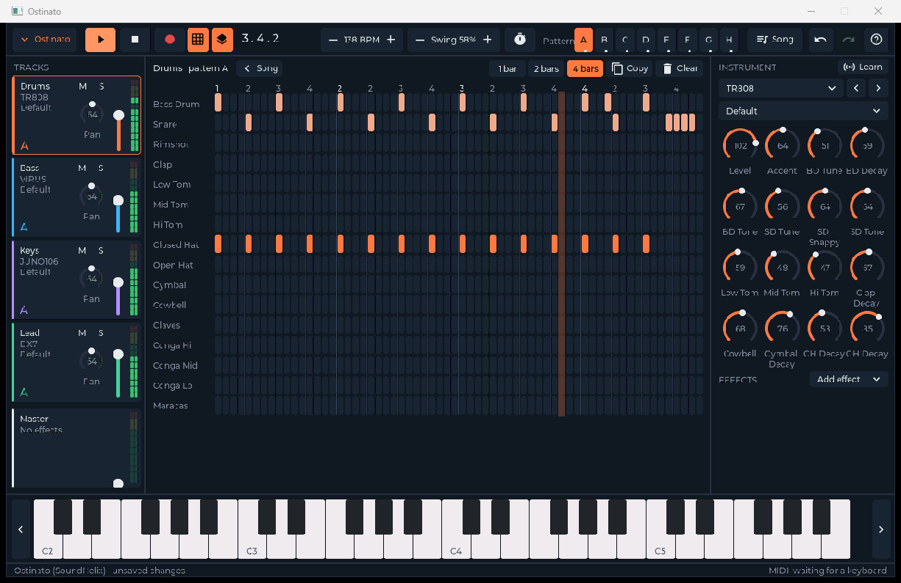

studio is a set of music applications built on the PyDevices audio and MIDI stack, on the desktop and on boards: a sound module that plays whatever a DAW or keyboard sends it, Ostinato, a pattern sequencer and song editor in your browser, and Vamp, which plays Ostinato's songs on a board.

## Install

studio is used from a clone, beside the libraries it builds on:

```bash
git clone https://github.com/PyDevices/studio
git clone https://github.com/PyDevices/audioinstruments
git clone https://github.com/PyDevices/audioeffects
git clone https://github.com/PyDevices/audiodsp
pip install ./audiodsp numpy
pip install --no-deps ./audioinstruments ./audioeffects/lib/audioeffects
```

## Try it

Render a MIDI file through the sound module to a WAV, with no MIDI hardware.
The sound comes from a General MIDI SoundFont (`.sf2`) that you supply, such
as [GeneralUser GS](https://schristiancollins.com/generaluser.php):

```bash
cd studio
python tools/render_mid.py tests/midi/musicbox1_spooky_waltz.mid take.wav --bank GeneralUser-GS.sf2 --path lib
```

It writes `take.wav`, 53 seconds of celesta, and prints what it measured:

```
notes 261
played 261
held 0
sounding 0
song 53.310
render 0.947
reverb 0
chorus 0
soundmodule: cpython 3.12.3 (linux): 0 bytes of MIDI, 0 Identity Requests answered, render behind by at most 0 ms while playing (0 ms before the first note)
  channel  1:  157 notes, bank 0:0 program 8, Celesta
  channel  2:   56 notes, bank 0:0 program 8, Celesta
  channel  3:   32 notes, bank 0:0 program 8, Celesta
  channel 16:   16 notes, bank 0:0 program 8, Celesta
```

`played` equals `notes` when every note sounded. The `render` and interpreter lines are yours to differ on.

[Docs](docs/index.md) | [Examples](apps/ostinato) | [Roadmap](ROADMAP.md)

Made by [PyDevices](https://pydevices.com).
